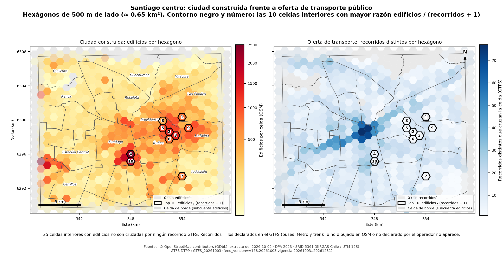
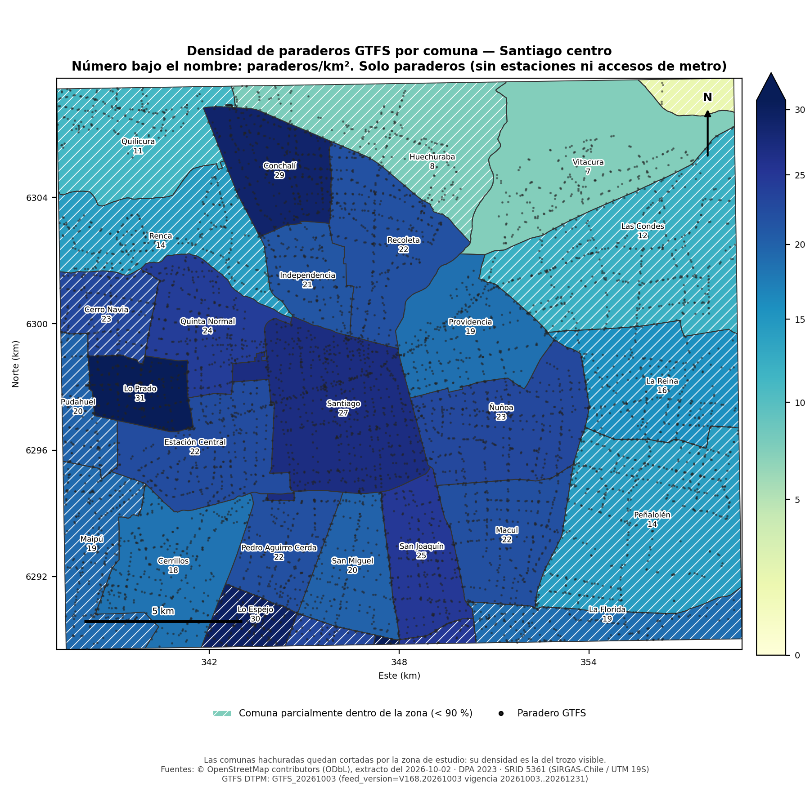

# Tarea 1 — PostGIS de punta a punta: Santiago centro

Procesamiento Masivo de Datos (ELE051-B / EIN102B · USM 2026-2) · Profesor: Diego Ramírez · Paralelo 701

**Integrantes:** Diego Peña - Benjamín Tello
**Repositorio:** https://github.com/diego-alonso23/Tarea-PostGIS.git

Pipeline geoespacial (fuente → carga → índices → transformación → consultas → mapas) que cruza
**OpenStreetMap** con el **GTFS del transporte público de Santiago (DTPM)** y la **División Política
Administrativa (comunas)**, todo en PostGIS y en **SRID 5361** (SIRGAS-Chile / UTM 19S).
Pregunta que ordena todo: ¿cómo se relaciona la ciudad construida (OSM) con la red de transporte público (GTFS)?

## Contenido

1. [Cómo reproducir desde cero](#1-cómo-reproducir-desde-cero)
2. [Fuentes: fecha y versión](#2-fuentes-fecha-y-versión)
3. [Decisiones técnicas](#3-decisiones-técnicas)
4. [Tablas, conteos e índices](#4-tablas-conteos-e-índices)
5. [Consultas (Parte C)](#5-consultas-parte-c)
6. [Mapas](#6-mapas)
7. [Índices que resultaron inútiles](#7-índices-que-resultaron-inútiles)
8. [Qué no funcionó](#8-qué-no-funcionó)

## Estructura del repositorio

```
├── docker-compose.yml        un servicio: PostGIS + ogr2ogr; monta datos/, sql/ y resultados/ (volumen con nombre: pgdata)
├── docker/Dockerfile         postgres:16-bookworm + postgis + gdal-bin (+ osmium para leer la fecha del PBF)
├── cargar.sh                 orquesta la carga: fuentes -> tablas creadas, indexadas y con ANALYZE
├── sql/                      1_base, 2_dpa, 3_osm, 4_gtfs_tablas, 5_gtfs, 6_indices  (ETL)
│                             7_consultas (Parte C), 8_mapas (vistas de los mapas), 9_planes (planes, Subdivide, uso de índices)
├── scripts/                  exportar_mapas.sh (GeoPackage) y mapas.py (PNG)
├── resultados/               resultados_consultas.txt, mapas.gpkg, mapa1_grilla.png, mapa2_densidad_paraderos.png — SÍ se versionan
├── datos/                    fuentes descargadas a mano (NO se versionan, ver .gitignore)
└── logs/                     avisos de ogr2ogr (no se versiona)
```

## 1. Cómo reproducir desde cero

**Reproducir el pipeline requiere solo tres cosas: dejar las fuentes en `datos/`, `docker compose up -d` y `./cargar.sh`.** Nada más.

**Requisitos:** Docker (Docker Desktop en Windows/macOS) con `docker compose` v2 y un shell bash (Linux, macOS o
**Git Bash** en Windows). ~6 GB libres en disco y ~4 GB de RAM para Docker.

1. Clonar el repositorio y crear la carpeta de datos:
   ```bash
   git clone https://github.com/diego-alonso23/Tarea-PostGIS.git && cd Tarea-PostGIS
   mkdir -p datos
   ```
2. Descargar las tres fuentes y dejarlas **tal cual** en `./datos/` (no se versionan):

   | Archivo en `datos/` | De dónde |
   |---|---|
   | `*.pbf` (extracto de Chile, p. ej. `chile-261002.osm.pbf`) | <https://download.geofabrik.de/south-america/chile-latest.osm.pbf> |
   | `GTFS_*.zip` (GTFS vigente, p. ej. `GTFS_20261003.zip`) | <https://www.dtpm.cl/index.php/noticias/gtfs-vigente> |
   | `comunas_cl.sql` (DPA 2023, Laboratorio 03) | repositorio del curso: `03/datos/comunas_cl.sql` |

   `comunas_cl.sql` se obtiene del repositorio del curso (Lab 03). Para generarla desde cero: descargar la DPA 2023 de
   <https://www.geoportal.cl/geoportal/catalog/download/912598ad-ac92-35f6-8045-098f214bd9c2> y ejecutar `preparar_datos.py` del Lab 03.
   El script detecta los archivos por patrón (`*.pbf`, `gtfs*.zip`, `comunas_cl.sql`); **no hay que editar rutas**.
3. Levantar PostGIS y cargar todo:
   ```bash
   docker compose up -d
   ./cargar.sh
   ```
   `cargar.sh` hace el ETL completo (~1–2 min) y deja todas las tablas creadas, indexadas y con `ANALYZE`.
   Es idempotente: se puede repetir y rehace todo desde cero.

Opciones de `cargar.sh`: otra caja con las variables `LON_MIN LAT_MIN LON_MAX LAT_MAX`, u otra carpeta de fuentes con `./cargar.sh /ruta/a/fuentes`.
Conexión desde el host (QGIS, psql): `localhost:5433`, base `postgres`, usuario/clave `postgres`.
Para empezar de cero también con el volumen: `docker compose down -v`.

### Opcional: consultas, planes y mapas (no son parte de la reproducción)

Una vez cargada la base (pasos anteriores), los resultados de la Parte C y los mapas se regeneran así:

```bash
# consultas P1–P7
docker compose exec -T db psql -U postgres -X -f /sql/7_consultas.sql > resultados/resultados_consultas.txt
# planes EXPLAIN ANALYZE, efecto de ST_Subdivide y uso de índices (después de las consultas)
docker compose exec -T db psql -U postgres -X -f /sql/9_planes.sql > resultados/planes_y_estado.txt
# mapas: GeoPackage + PNG (los PNG requieren: pip install geopandas matplotlib; el GeoPackage se abre igual en QGIS)
./scripts/exportar_mapas.sh
```

Los archivos ya generados están en `resultados/`.

## 2. Fuentes: fecha y versión

| Fuente | Versión usada |
|---|---|
| OpenStreetMap — extracto de Chile (Geofabrik) | `chile-261002.osm.pbf` · marca de tiempo del extracto **2026-10-02T20:21:34Z** · licencia ODbL |
| GTFS vigente DTPM | `GTFS_20261003.zip` · `feed_version = V168.20261003` · vigencia **2026-10-03 a 2026-12-31** |
| DPA 2023 — comunas | `comunas_cl.sql` (Laboratorio 03), 345 comunas |
| Zona `santiago-centro` | caja lon −70,75…−70,52 · lat −33,52…−33,36 (parámetros de `cargar.sh`; no se achicó con `--bbox`) |

Las conclusiones de este documento y de los mapas corresponden a estas fuentes y fechas. Los paraderos de OSM son los que
alguien dibujó; el GTFS es lo que el operador declara.

## 3. Decisiones técnicas

- **SRID 5361** para todo. OSM y GTFS vienen en 4326 y se transforman al cargar; `comunas_cl` ya viene en 5361
  (`sql/2_dpa.sql` aborta si no lo está).
- **Carga de OSM: `ogr2ogr` con filtro espacial `-spat`** directo sobre el PBF de Chile, con `other_tags` como
  `hstore` (de ahí se saca `amenity` de los nodos). Es el equivalente justificado del `preparar_datos.py` del
  Lab 05: tarda ~15 s y usa ~200 MB de RAM. Los objetos que cruzan el borde de la caja quedan **completos** (no recortados).
- **Reparación de geometrías (`ST_MakeValid` + `ST_CollectionExtract(…, 3)`):**
  de 146 675 multipolígonos OSM cargados, **291 eran inválidos**; **181** de ellos eran edificios.
  Tras repararlos, **155 edificios se descartaron** por quedar vacíos o sin área, y **26 edificios reparados** están en la tabla final
  (`edificios.reparada = true`). GDAL además emitió 86 avisos de anillos degenerados al ensamblar (`logs/ogr2ogr.log`).
  Las comunas no necesitaron reparación (0 inválidas); `comunas_sub` igual pasa por `ST_MakeValid`.
- **Edificios: polígono *y* punto interior.** Se conserva `geom` (MultiPolygon, para áreas e intersecciones) y se agrega
  `geom_pt = ST_PointOnSurface(geom)`, que a diferencia del centroide siempre cae dentro del edificio y hace baratos los joins
  punto-en-polígono y `ST_DWithin`. Las consultas de cobertura (P2) y de grilla (P6) usan `geom_pt`; cada edificio cuenta una sola vez.
- **Amenidades:** nodos con `amenity` más áreas con `amenity` representadas por su punto interior (columna `origen`).
- **`paraderos_osm`:** `highway = 'bus_stop'`.
- **`paraderos_gtfs`:** `stops.txt` → `ST_Transform(ST_SetSRID(ST_MakePoint(lon, lat), 4326), 5361)`, recortado a la caja
  **en la base**. Se conserva `location_type`: incluye paraderos (vacío o `0`), estaciones (`1`) y accesos de metro (`2`).
  Las consultas filtran `location_type IS NULL OR location_type IN ('', '0')` para no contar dos veces una misma estación.
- **`recorridos`:** `shapes.txt` se carga con `\copy` a `gtfs_raw.shapes` y la línea se construye en SQL con
  `ST_MakeLine(punto ORDER BY shape_pt_sequence)`. **Una fila por `shape_id`**: ida, vuelta y variantes de una misma ruta quedan
  como filas distintas (con `route_short_name` y `direction_id` para agruparlas). La ruta se asocia vía `trips.txt → routes.txt`
  (ningún shape lo usa más de una ruta). Se descartan shapes con < 2 puntos y los 122 que ningún viaje usa; los que cruzan la caja
  se guardan **completos** (708 recorridos). Consecuencia: "recorridos distintos" se cuenta por `route_short_name`, y los kilómetros
  suman todos los shapes (ida + vuelta + variantes), así que miden longitud de trazados, no longitud de red.
- **`stop_times.txt`:** 1 098 529 filas, cargado con `\copy` (no INSERT fila por fila) a `gtfs_raw.stop_times`; de ahí sale `viajes_por_paradero`.
- **DPA:** `comunas_cl` tal cual el Lab 03 (con su GIST). Además `comunas_sub`: `ST_Subdivide(…, 256)` solo de las comunas que
  tocan la caja (86 piezas), usada en P2 y P4.
- **Comunas parciales:** la caja corta varias comunas. En P1 la densidad usa el área de la comuna **recortada a la caja**
  (`zona`), no la comuna completa. En P4 los trazados se recortan al límite comunal (como pide el enunciado) pero **no a la caja**:
  los kilómetros incluyen la parte del trazado que está fuera de la caja dentro de esa comuna.

## 4. Tablas, conteos e índices

<!-- ESTADO:BEGIN -->
_Generado el 2026-10-14 22:26 UTC desde la bitácora `etl_log` y el catálogo de PostgreSQL. Los conteos exactos de la corrida final se regeneran con `sql/9_planes.sql` (sección 1)._

**Fuentes**

| Fuente | Detalle |
|---|---|
| fuente_osm | chile-261002_osm.pbf |
| fuente_gtfs | GTFS_20261003.zip |
| fuente_dpa | comunas_cl.sql |
| fuente_osm_fecha | 2026-10-02T20:21:34Z |
| fuente_gtfs_feed | feed_version=V168.20261003 vigencia 20261003..20261231 |

**Tablas y conteos** (SRID 5361 en todas las geometrías)

| Tabla | Filas |
|---|---:|
| public.amenidades | 20847 |
| public.calles | 100826 |
| public.comunas_cl | 345 |
| public.comunas_sub | 86 |
| public.edificios | 118778 |
| public.paraderos_gtfs | 7162 |
| public.paraderos_osm | 6568 |
| public.recorridos | 708 |
| public.viajes_por_paradero | 6811 |
| public.zona | 1 |
| gtfs_raw.feed_info | 1 |
| gtfs_raw.routes | 428 |
| gtfs_raw.shape_ruta | 859 |
| gtfs_raw.shapes | 456573 |
| gtfs_raw.stop_times | 1098529 |
| gtfs_raw.stops | 18455 |
| gtfs_raw.trips | 26159 |

**Índices** (`usos` = idx_scan acumulado; se revisa de nuevo al terminar la Parte C)

| Tabla | Índice | Tipo / columna | usos |
|---|---|---|---:|
| amenidades | amenidades_pkey | btree (id) | 0 |
| amenidades | idx_amenidades_amenity | btree (amenity) | 2 |
| amenidades | idx_amenidades_geom | gist (geom) | 0 |
| calles | calles_pkey | btree (id) | 0 |
| calles | idx_calles_geom | gist (geom) | 0 |
| calles | idx_calles_highway | btree (highway) | 2 |
| comunas_cl | comunas_cl_geom_idx | gist (geom) | 1 |
| comunas_cl | comunas_cl_pkey | btree (gid) | 0 |
| comunas_sub | idx_comunas_sub_geom | gist (geom) | 0 |
| edificios | edificios_pkey | btree (id) | 2 |
| edificios | idx_edificios_geom | gist (geom) | 0 |
| edificios | idx_edificios_geom_pt | gist (geom_pt) | 0 |
| paraderos_gtfs | idx_paraderos_gtfs_geom | gist (geom) | 0 |
| paraderos_gtfs | paraderos_gtfs_pkey | btree (stop_id) | 0 |
| paraderos_osm | idx_paraderos_osm_geom | gist (geom) | 0 |
| paraderos_osm | paraderos_osm_pkey | btree (id) | 2 |
| recorridos | idx_recorridos_geom | gist (geom) | 0 |
| recorridos | idx_recorridos_ruta | btree (route_short_name) | 0 |
| recorridos | recorridos_pkey | btree (shape_id) | 1 |
| viajes_por_paradero | viajes_por_paradero_pkey | btree (stop_id) | 0 |
| zona | idx_zona_geom | gist (geom) | 0 |

**Bitácora de la carga** (reparaciones, descartes, conteos crudos)

| Paso | Detalle | N |
|---|---|---:|
| dpa | comunas totales en comunas_cl | 345 |
| dpa | comunas con geometria invalida (se reparan solo en comunas_sub) | 0 |
| osm_ogr2ogr | avisos de GDAL al ensamblar geometrias (logs/ogr2ogr.log) | 86 |
| osm_raw | points | 254955 |
| osm_raw | lines | 169689 |
| osm_raw | multipolygons | 146675 |
| osm_repair | multipolygons (todos) con geometria invalida | 291 |
| osm_repair | edificios con geometria invalida -> ST_MakeValid | 181 |
| osm_repair | edificios descartados (irreparables: vacios o sin area tras ST_MakeValid) | 155 |
| osm_repair | edificios reparados presentes en la tabla final | 26 |
| gtfs_raw | stops.txt | 18455 |
| gtfs_raw | routes.txt | 428 |
| gtfs_raw | trips.txt | 26159 |
| gtfs_raw | shapes.txt | 456573 |
| gtfs_raw | stop_times.txt (cargado con \copy) | 1098529 |
| gtfs_clip | stops fuera de la caja (descartados) | 11293 |
| gtfs_shapes | shape_id usados por mas de una ruta | 0 |
| gtfs_shapes | shape_id distintos en shapes.txt | 981 |
| gtfs_shapes | shape_id sin ningun viaje en trips.txt (excluidos) | 122 |
| gtfs_shapes | shapes que cruzan la caja y quedan en recorridos | 708 |
| gtfs_shapes | recorridos de largo 0 (degenerados) | 0 |
<!-- ESTADO:END -->

Todas las geometrías están en SRID 5361. Cada tabla derivada tiene su índice espacial (GIST) y `ANALYZE` al final de `cargar.sh`.
`calles`, `edificios` (dos GIST: `geom` y `geom_pt`), `paraderos_osm`, `amenidades`, `paraderos_gtfs`, `recorridos` (GIST + btree en `route_short_name`),
`comunas_sub` y `zona` tienen índice espacial; `mv_grilla` (vista materializada de `sql/8_mapas.sql`) también.

## 5. Consultas (Parte C)

Código en `sql/7_consultas.sql`; salida completa en `resultados/resultados_consultas.txt`; planes en `resultados/planes_y_estado.txt`
(generados con `sql/9_planes.sql`). Los resultados de abajo son de las fuentes de la sección 2.

### P1. Paraderos por comuna y densidad (join punto-en-polígono)

Se recorta cada comuna a la caja con `ST_Intersection` y se cuentan los paraderos GTFS (sin estaciones ni accesos) con `ST_Contains`.
Se asignan 6 810 paraderos a 30 comunas.

| Comuna | Paraderos | Área en la caja (km²) | Paraderos/km² |
|---|---:|---:|---:|
| San Ramón | 6 | 0,17 | 35,85 |
| Lo Prado | 201 | 6,54 | 30,72 |
| Lo Espejo | 120 | 4,06 | 29,59 |
| Conchalí | 317 | 10,94 | 28,98 |
| Santiago | 624 | 23,18 | 26,92 |
| … | | | |
| Huechuraba | 163 | 20,96 | 7,78 |
| Vitacura | 194 | 26,33 | 7,37 |
| Lo Barnechea | 5 | 2,80 | 1,79 |

**Interpretación:** las comunas del centro y poniente (Lo Prado, Lo Espejo, Conchalí, Santiago) concentran más paraderos por km²;
las del oriente y norte (Vitacura, Huechuraba, Lo Barnechea) son las menos densas. San Ramón y Lo Barnechea tienen muy poca área dentro de la caja
(0,17 y 2,80 km²), así que su densidad es la de un trozo pequeño y no representa a la comuna. Fuente: GTFS `GTFS_20261003` + DPA 2023.
Mapa: sección 6.

### P2. Cobertura: edificios a más de 500 m de un paradero (anti-join con `ST_DWithin`)

Anti-join `NOT EXISTS` + `ST_DWithin(geom_pt, paradero, 500)` sobre `edificios.geom_pt`, una vez con paraderos GTFS y otra con paraderos OSM.
Sumando las 30 comunas: **118 973 edificios; 1 347 (1,13 %) a más de 500 m de un paradero GTFS y 1 156 (0,97 %) a más de 500 m de un paradero OSM.**

| Comuna | Edificios | % sin GTFS | % sin OSM |
|---|---:|---:|---:|
| Lo Barnechea | 76 | 61,84 | 61,84 |
| Huechuraba | 1 268 | 10,73 | 10,41 |
| Quilicura | 2 291 | 7,46 | 7,55 |
| La Florida | 953 | 4,51 | 4,51 |
| Vitacura | 4 014 | 3,96 | 3,94 |
| Providencia | 12 133 | 0,73 | 0,15 |
| La Reina | 11 878 | 1,76 | 1,25 |
| Recoleta | 3 086 | 1,88 | 0,97 |
| Santiago, Ñuñoa, Macul, San Joaquín, San Miguel y otras 10 | | 0,00 | 0,00 |

**Interpretación:** casi toda la ciudad construida está a menos de 500 m de un paradero, con cualquiera de las dos fuentes. La conclusión no cambia según la fuente:
las comunas con más edificios sin cobertura son las mismas (Lo Barnechea, Huechuraba, Quilicura). Las diferencias aparecen en Providencia, La Reina y Recoleta, donde OSM
deja menos edificios sin cobertura que el GTFS: lo que sugiere que en esas comunas OSM tiene paraderos que el GTFS no declara cerca de esos edificios. Lo Barnechea (76 edificios en la caja)
está en el borde y no es concluyente. Fuente: OSM 2026-10-02 y GTFS `GTFS_20261003`.

### P3. Dos fuentes, un objeto (anti-join en los dos sentidos, 50 m)

| Paraderos GTFS | GTFS sin bus stop OSM a < 50 m | Bus stops OSM | OSM sin paradero GTFS a < 50 m |
|---:|---:|---:|---:|
| 6 812 | 448 (6,6 %) | 6 572 | 361 (5,5 %) |

**Interpretación:** más de 9 de cada 10 objetos tienen su par en la otra fuente, así que las dos describen en gran medida la misma red.
Ninguna fuente es completa: 448 paraderos declarados por el operador no están dibujados en OSM, y 361 bus stops de OSM no tienen paradero GTFS cerca
(pueden estar mal ubicados, ser paraderos que el operador no declara o haber dejado de existir). El umbral de 50 m también influye: un paradero GTFS desplazado más que eso aparece como faltante en ambos sentidos.

### P4. Kilómetros de recorrido por comuna (líneas contra polígonos)

`ST_Length(ST_Intersection(recorrido, comuna_sub))` sumado por comuna, usando `comunas_sub`. El efecto de `ST_Subdivide` en el tiempo se mide en `sql/9_planes.sql` (sección 4),
que calcula la misma suma con `comunas_cl` (polígonos completos) y con `comunas_sub`.

| Comuna | Shapes | Rutas distintas | km de trazado |
|---|---:|---:|---:|
| Santiago | 323 | 156 | 1 339,99 |
| Maipú | 139 | 65 | 1 283,86 |
| La Florida | 156 | 67 | 840,46 |
| Pudahuel | 149 | 69 | 798,48 |
| Las Condes | 139 | 74 | 767,66 |
| … | | | |
| San Ramón | 65 | 30 | 155,24 |

*(30 comunas; la tabla completa está en `resultados/resultados_consultas.txt`.)*

**Interpretación:** Santiago es la comuna con más kilómetros de trazado y más rutas distintas (156). Maipú, La Florida y Pudahuel aparecen altos porque los shapes
se recortan al límite comunal pero no a la caja: incluyen trazados fuera de la zona de estudio (por ejemplo Maipú tiene solo ~11 km² dentro de la caja). Además, ida, vuelta y variantes
suman por separado, así que los km no son longitud de red. Efecto de `ST_Subdivide` en el tiempo: **tiempos con `comunas_cl` vs `comunas_sub`: PENDIENTE (pegar la salida de `\timing` de `resultados/planes_y_estado.txt`).**

### P5. Vecino más cercano (`CROSS JOIN LATERAL` + `<->` + `LIMIT 1`)

Ruta elegida: `route_short_name = '210'`. Para cada paradero GTFS de esa ruta se busca la farmacia, hospital, clínica o consultorio (`amenity` en `pharmacy, hospital, clinic, doctors`)
más cercano. Los 15 paraderos con la menor distancia:

| Paradero | Más cercano | Tipo | Distancia (m) |
|---|---|---|---:|
| PA168 · (M) Santa Lucía | Farmacias del Dr. Simi | pharmacy | 5,3 |
| PA215 · (M) La Moneda | Cruz Verde | pharmacy | 9,9 |
| PA187 · (M) República | Farmacia Ochoa | pharmacy | 17,2 |
| PA184 · (M) La Moneda | SalcoBrand | pharmacy | 19,7 |
| PI440 · San Borja | Naturland | pharmacy | 25,8 |
| … | | | |
| PE1499 · Av. Vicuña Mackenna / esq. El Manzano | Fonasa | clinic | 42,7 |

**Interpretación:** los 15 paraderos de la ruta 210 más cercanos a un servicio de salud tienen uno a menos de 45 m (casi todos, una farmacia). La tabla muestra solo los 15 más cercanos (`LIMIT 15` sobre el resultado ordenado),
así que no resume la distancia típica de toda la ruta. Fuente: GTFS `GTFS_20261003` y OSM 2026-10-02.

### P6. Grilla hexagonal de 500 m (`ST_HexagonGrid` + vista materializada)

`mv_grilla` (definida en `sql/8_mapas.sql`): hexágonos de 500 m de lado (≈ 0,65 km²) sobre la caja; 682 celdas, 525 completamente dentro de la caja (`interior`).
`n_edificios` cuenta puntos interiores de edificios; `n_recorridos` cuenta `route_short_name` distintos cuyos shapes cruzan la celda.
**Criterio del top 10:** mayor razón `n_edificios / (n_recorridos + 1)`, solo celdas interiores (los edificios solo existen dentro de la caja, así que las celdas de borde subcuentan).

| # | Celda | Edificios | Recorridos distintos |
|---:|---:|---:|---:|
| 1 | 519 | 755 | 0 |
| 2 | 473 | 1 344 | 3 |
| 3 | 495 | 1 321 | 3 |
| 4 | 338 | 2 450 | 7 |
| 5 | 452 | 1 028 | 3 |
| 6 | 472 | 765 | 2 |
| 7 | 511 | 702 | 2 |
| 8 | 453 | 456 | 1 |
| 9 | 540 | 894 | 3 |
| 10 | 337 | 1 870 | 10 |

**Interpretación:** hay 25 celdas interiores con edificios que ningún recorrido GTFS cruza. Las 10 celdas del ranking se concentran en el sector oriente
(Providencia, Ñuñoa, La Reina y una en Peñalolén) y en dos celdas del centro-sur de Santiago; son zonas muy construidas con pocos recorridos que las crucen. La razón `edificios / (recorridos + 1)` es una decisión nuestra:
otro criterio (por ejemplo, solo celdas con 0 recorridos) da otro ranking. Los recorridos son los declarados en el GTFS (buses, Metro y tren).
Fuente: OSM 2026-10-02 y GTFS `GTFS_20261003`. Este es el mapa principal (sección 6).

### P7. La propia: ¿qué hay cerca de los paraderos con más viajes? (viajes GTFS × amenidades OSM)

Cruza `viajes_por_paradero` (desde `stop_times.txt`, GTFS) con `amenidades` (OSM) a 100 m de cada paradero: cuántas amenidades y cuántos tipos distintos.

| Paradero | Viajes | Amenidades a 100 m | Tipos distintos |
|---|---:|---:|---:|
| Pedro de Valdivia (L1) | 1 353 | 34 | 10 |
| Los Leones (L1) | 1 353 | 33 | 12 |
| Manuel Montt (L1) | 1 353 | 33 | 11 |
| El Golf (L1) | 1 353 | 25 | 15 |
| Tobalaba (L1) | 1 353 | 25 | 11 |
| Salvador (L1) | 1 353 | 7 | 7 |
| Baquedano (L1) | 1 353 | 7 | 6 |

**Interpretación:** los 15 paraderos con más viajes son todos estaciones de la Línea 1 del Metro, empatados en 1 353 viajes, por lo que el orden entre ellos depende del `ORDER BY` y no del dato.
Dentro de la L1, las estaciones del sector oriente (Pedro de Valdivia, Los Leones, Manuel Montt, El Golf) tienen más amenidades OSM a 100 m que Salvador o Baquedano.
El ranking no incluye paraderos de buses. Fuente: GTFS `GTFS_20261003` y OSM 2026-10-02.

### Planes de ejecución (`EXPLAIN ANALYZE`)

`sql/9_planes.sql` genera, para P3, P5 y P6, el plan con índice y, para P3 y P6, el plan con los índices desactivados (`enable_indexscan/bitmapscan = off`) para ver qué pasaría sin ellos.
Pegar abajo el extracto relevante de `resultados/planes_y_estado.txt` y comentar qué índice se usa, de qué lado y cuánto cambia el tiempo.

| Consulta | Plan con índice | Tiempo | Sin índice | Tiempo |
|---|---|---:|---|---:|
| P3 (anti-join GTFS→OSM, 50 m) | PENDIENTE (índice esperado: `idx_paraderos_osm_geom`, lado interno del anti-join) | PENDIENTE | PENDIENTE | PENDIENTE |
| P5 (KNN ruta 210) | PENDIENTE (índice esperado: `idx_amenidades_geom`, orden por `<->`) | PENDIENTE | — | — |
| P6 (edificios por celda) | PENDIENTE (índice esperado: `idx_edificios_geom_pt`, lado interno del join) | PENDIENTE | PENDIENTE | PENDIENTE |

## 6. Mapas

Archivos exportados (en el repositorio): `resultados/mapas.gpkg` (capas `grilla`, `comunas_densidad`, `paraderos`, `fuentes`; SRID 5361) y los PNG.
Se generan con `./scripts/exportar_mapas.sh` desde las vistas de `sql/8_mapas.sql`. Cada mapa lleva título, escala de color, escala gráfica, norte y las fuentes y fechas (leídas de la capa `fuentes`, no escritas a mano).

**Mapa 1 (principal) — ciudad construida frente a oferta de transporte (P6):** `resultados/mapa1_grilla.png`



**Mapa 2 — densidad de paraderos GTFS por comuna (P1):** `resultados/mapa2_densidad_paraderos.png`



Datos: OSM extracto 2026-10-02; GTFS `GTFS_20261003` (vigencia 2026-10-03 a 2026-12-31); DPA 2023.

## 7. Índices que resultaron inútiles

Se revisa con `pg_stat_user_indexes` (`sql/9_planes.sql`, sección 5, que se corre al final porque `idx_scan` es acumulado). Un índice con `idx_scan = 0` es un hallazgo, no un error.

En el estado de la sección 4 (tomado antes de correr la Parte C) casi todos los índices tienen 0 usos, así que ese estado no sirve para concluir nada.
Hipótesis que se confirman o descartan con la salida de la sección 5 de `resultados/planes_y_estado.txt` (**PENDIENTE: confirmar con los números finales**):

- **`*_pkey` de `edificios`, `calles`, `amenidades`:** probablemente 0 usos, porque ninguna consulta busca registros por `id`; existen para tener una clave primaria.
- **`idx_zona_geom`:** `zona` tiene una sola fila; para el planificador es más barato leer la tabla que usar el índice.
- **`idx_edificios_geom` (polígono):** las consultas P2 y P6 usan `geom_pt`; el índice sobre `geom` solo serviría para consultas de polígono contra polígono, que no se hacen.
- **`idx_calles_geom`, `idx_calles_highway`:** ninguna consulta de la Parte C usa calles.

## 8. Qué no funcionó

- **`osmium extract -s smart` / `complete_ways`** sobre el PBF de Chile pedía > 3 GB de RAM y el proceso moría por falta de memoria. Se reemplazó por `ogr2ogr -spat`.
- **`apt-get` dentro de la imagen `postgis/postgis:16-3.4`**: esa imagen es Debian *bullseye* y su repositorio `apt.postgresql.org … bullseye-pgdg` ya no existe (404). Se construye sobre `postgres:16-bookworm` (instalando `postgresql-16-postgis-3` y `gdal-bin`).
- **Git Bash en Windows** reescribe argumentos que empiezan con `/` (p. ej. `/datos/...`). `cargar.sh` desactiva esa conversión (`MSYS_NO_PATHCONV`). Los scripts se editaron en Windows con fin de línea CRLF: `.gitattributes` fuerza LF.
- **Cabeceras del GTFS:** `COPY` no mapea por nombre de columna; si el GTFS cambia de columnas, `cargar.sh` se detiene con un mensaje claro en vez de cargar datos desordenados.
- **Primer criterio del top 10 de la grilla** (`ORDER BY num_rutas ASC, num_edificios DESC`): quedaban solo celdas con 0 recorridos, incluidas celdas de borde donde los edificios están subcontados. Se reemplazó por la razón `edificios / (recorridos + 1)` sobre celdas interiores.
- **Scripts de mapas con rutas equivocadas:** apuntaban a `consultas/` y `salidas/` (que no existen) y a vistas no creadas; se movieron las vistas a `sql/8_mapas.sql` y las salidas a `resultados/`.
- **P7:** al ordenar por `n_viajes`, el top 15 son estaciones de la L1 empatadas en 1 353 viajes; el ranking no distingue entre ellas.
